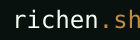

<h1>
  
  <br>
  
</h1>


a terminal emulator in the browser with persistent filesystem and command system

## features

- **interactive terminal** - full command line interface with history
- **virtual filesystem** - persistent file operations with localStorage
- **command system** - persistent command history
- **static pages** - direct url access to command outputs

## commands

### filesystem

- `ls [path]` - list directory contents
- `cd [path]` - change directory
- `cat [file]` - display file contents
- `mkdir [dir]` - create directory
- `touch [file]` - create file
- `rm [path]` - remove file or directory
- `mv [src] [dest]` - move/rename files
- `cp [src] [dest]` - copy files
- `cwd` - show current directory

### utilities

- `help` - show available commands
- `clear` - clear terminal screen
- `echo [text]` - display text
- `neofetch` - system information display

### interactive

- `shader [mode] [example]` - run shader examples

### others

- `projects` - display project portfolio
- `contact` - show contact information

## development

the project is a vite multi-page app with HTML entries in `routes/` and public URLs at `/`, `/projects/`, `/contact/`, and `/blog/`.

```bash
direnv allow
pnpm install --frozen-lockfile
pnpm dev
```

`direnv allow` loads the nix flake, which provides node.js and pnpm. see [DEVELOPMENT.md](./DEVELOPMENT.md) for build, preview, validation, and deployment details.

for project notes see [docs/richensh.md](./docs/richensh.md)
